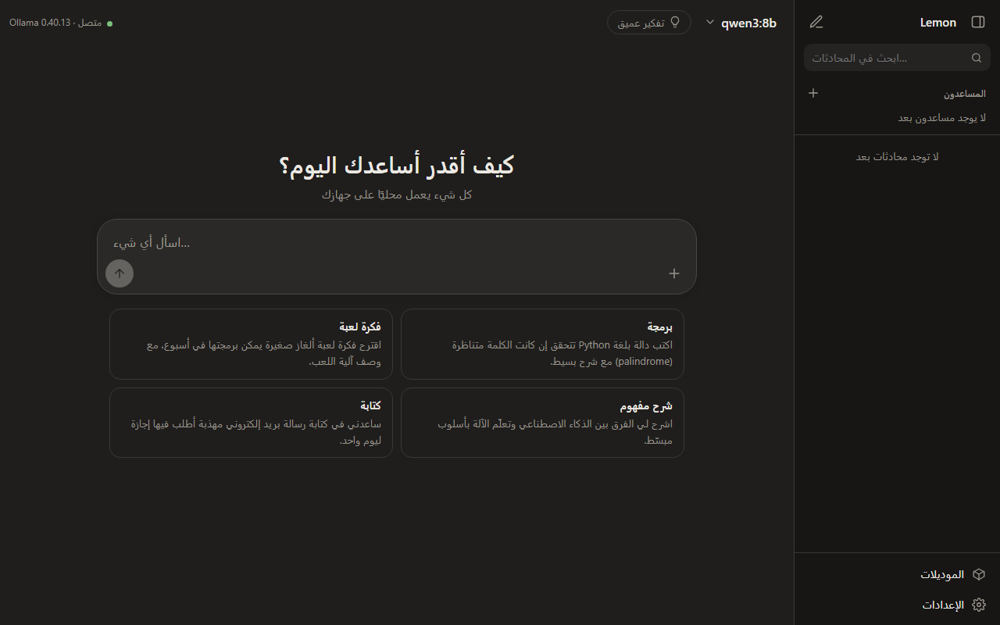
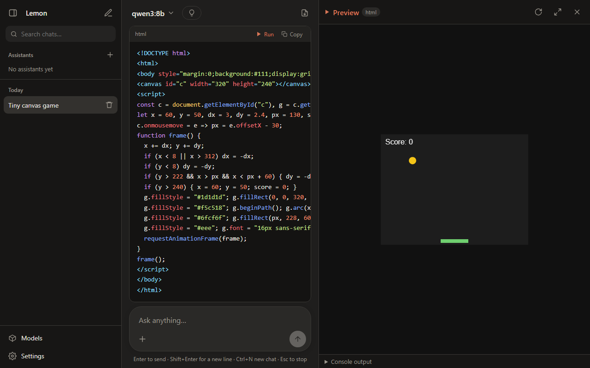

# 🍋 Lemon — Local AI Chat

**[English](README.en.md)** · العربية

برنامج ويندوز للمحادثة مع نماذج الذكاء الصناعي المحلية عبر [Ollama](https://ollama.com).
ملف `exe` واحد، يعمل بدون إنترنت، ويدعم العربية والإنجليزية بالكامل. مفتوح المصدر (رخصة MIT).

## المميزات

- 💬 **محادثة** بواجهة مثل ChatGPT/Claude مع بث مباشر للرد، و«تفكير عميق» للموديلات التي تدعمه.
- 🌐 **عربي وإنجليزي**: تبديل فوري من الإعدادات، مع اتجاه صحيح (RTL/LTR) في كل مكان.
- 🧠 **المساعدون المخصّصون**: أعطِ المساعد ملفاتك (PDF، نصوص، كود) أو ملاحظاتك، فيجيب **منها فقط** ويعرض المصادر.
  - **الفهم العميق** (مفعّل للمساعدين الجدد): يقرأ الموديل كل مستند ويكتب له ملخصًا منظمًا (الأقسام، الأرقام، الشروط)، ويعيد صياغة أسئلة المتابعة، ويعطي الموديل المقاطع مع ما قبلها وما بعدها ضمن سياق أطول؛ فيجيب أدق عن الأسئلة الشاملة والمقارنات. الفهرسة أبطأ: في تجربتنا على RTX 2070 (8 GB) مع qwen3:8b استغرق ملف PDF عربي من 6 صفحات نحو 95 ثانية، وملف إنجليزي من 5 صفحات نحو 37 ثانية (بدل ثانية واحدة دون الفهم العميق).
  - في محرر المساعد: قوالب تعليمات جاهزة (قانوني، معلّم، خدمة عملاء، بحثي، موارد بشرية، توثيق تقني)، وزر «ماذا قرأ؟» لعرض النص المستخرج والملخص وتعديله، ولوحة «تجربة المساعد».
  - موديل الفهرسة يُختار من قائمة مقترحة (الحجم، دعم العربية، ومدى مناسبته لجهازك، ومثبّت أم لا) مع زر تنزيل؛ ويمكن كتابة أي موديل آخر.
  - ملفات PDF الممسوحة ضوئيًا (صور بلا نص) لا تُقرأ: ارفع نسخة عليها نص (OCR).
- ▶️ **معاينة مباشرة**: شغّل كود HTML/JS/SVG (مثل الألعاب) داخل البرنامج، مع التقاط الأخطاء وزر «اطلب الإصلاح».
- 🎨 **تلوين الكود** يعمل بدون إنترنت، وأزرار نسخ وتشغيل لكل كتلة كود.
- 📦 **إدارة الموديلات**: تنزيل وحذف، مع **اقتراحات حسب قوة جهازك** (كرت الشاشة والرام): ينصح / يعمل ببطء / لا ينصح.
- 📎 إرفاق ملفات، بحث في المحادثات، إعادة تسمية، تصدير إلى Markdown.
- 🔄 **تحديث تلقائي** من GitHub Releases بضغطة زر، مع التحقق من سلامة الملف.
- 🔒 كل شيء على جهازك: لا تتبّع، والخادم المحلي يرفض أي طلب من مواقع أخرى.





## التثبيت

1. ثبّت [Ollama](https://ollama.com/download).
2. نزّل `local-ai-chat.exe` من صفحة [الإصدارات](https://github.com/sarmadiq9090-coder/local-ai-chat/releases) وشغّله.
3. من «الموديلات» اختر موديلًا مقترحًا لجهازك ونزّله.

## البناء

```bash
cargo build --release
```

الناتج: `target\release\local-ai-chat.exe` (الواجهة مضمّنة داخله).

المتطلبات: Rust (MSVC)، WebView2 (موجود في ويندوز 11)، و Ollama.

نشر إصدار جديد وتوقيعه (للمالك): [RELEASING.md](RELEASING.md).

## هيكل المشروع

```
src/
  main.rs              نقطة البداية: تشغيل الخادم في خيط + النافذة في الخيط الرئيسي
  config.rs            الإعدادات ومسارات الملفات
  error.rs             نوع أخطاء الـ API (يُرجع {"error": ...})
  storage.rs           حفظ المحادثات (ملف JSON لكل محادثة)
  ollama.rs            فحص Ollama وتشغيله تلقائيًا
  window.rs            النافذة (tao) + WebView2 (wry)
  system.rs            مواصفات الجهاز (كرت الشاشة وذاكرته، الرام، المعالج) لاقتراح الموديلات
  server/
    mod.rs             إنشاء الخادم والحالة المشتركة (AppState) وتجميع المسارات
    routes/            /api/app/*   ملف لكل ميزة: status, settings, conversations, export, system
      mod.rs           يدمج موجّهات الميزات (سطر واحد لكل ميزة)
    ollama_proxy.rs    /api/ollama/* تمرير مباشر (مع البث) إلى Ollama
    assets.rs          ملفات الواجهة المضمّنة
ui/
  index.html           هيكل الصفحة + رابط CSS لكل ميزة
  main.js              الإقلاع: يشغّل كل الميزات المذكورة في features/index.js
  core/                المشترك: api, state, dom, icons, markdown, i18n, strings + base.css (الألوان والتخطيط والمكوّنات العامة)
  features/
    index.js           القائمة الوحيدة للميزات (ترتيبها = ترتيب التشغيل وأولوية زر Esc)
    chat/ sidebar/ models/ settings/ preview/ status/ exporter/ code/
                       لكل ميزة: ملف js وملف css وملف strings.js (النصوص بالعربية والإنجليزية)
  vendor/              highlight.js لتلوين الكود
docs/API.md            عقد الـ API بين الخادم والواجهة
ROADMAP.md             قائمة التحسينات المنجزة والقادمة
```

## مكان البيانات

| البيان | المسار |
|---|---|
| المحادثات | `%APPDATA%\LocalAiChat\conversations\*.json` |
| الإعدادات | `%APPDATA%\LocalAiChat\settings.json` |
| التصدير | `Documents\LocalAiChat\` |
| سجل الأعطال (سبب أي توقّف مفاجئ، أرفقه عند الإبلاغ عن مشكلة) | `%APPDATA%\LocalAiChat\crash.txt` |

## كيف تضيف ميزة

- **ميزة جديدة في الواجهة**: مجلد `ui/features/<name>/` فيه `<name>.js` و `strings.js` و `<name>.css`، ثم سطر في `ui/features/index.js` وسطر `<link>` في `ui/index.html`. التفاصيل في `CLAUDE.md`.
- **Endpoint جديد**: ملف `src/server/routes/<name>.rs` فيه `router()`، ثم سطر في `src/server/routes/mod.rs`، ووثّقه في `docs/API.md`.
- **حقل جديد في المحادثة/الرسالة**: من الواجهة فقط؛ الخادم يحفظ أي حقول إضافية كما هي.
- **إعداد جديد**: أضف الحقل في `Settings` (`src/config.rs`) مع قيمته الافتراضية، ثم في `ui/features/settings/settings.js`.
- **نص جديد في الواجهة**: في ملف `strings.js` الخاص بالميزة (العربية `ar` والإنجليزية `en`)؛ لا تكتب النصوص مباشرة في الكود.
- **استدعاء Ollama جديد**: متاح مباشرة عبر `/api/ollama/<endpoint>` من `ui/core/api.js`.
