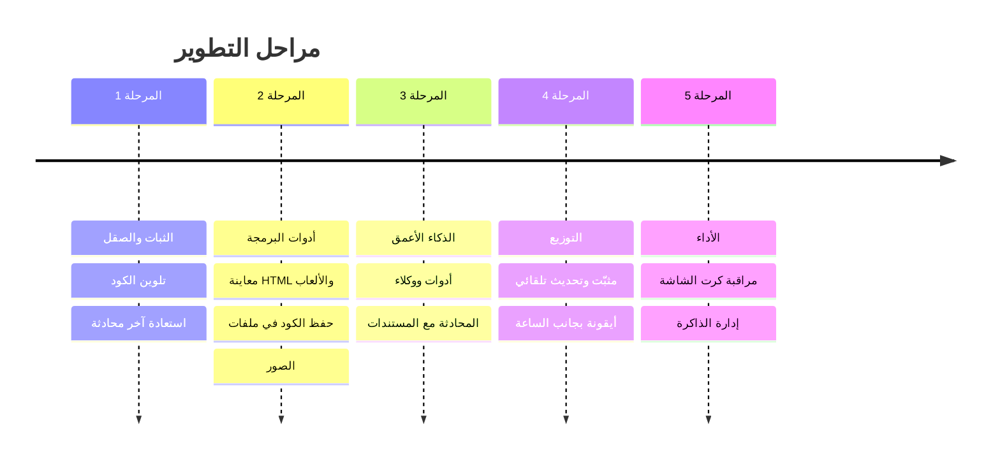

# خارطة التحسينات — الذكاء المحلي

**الإصدار الحالي:** 2.0.0 (Rust + WebView2)
**الهدف:** برنامج ويندوز محلي للمحادثة وبرمجة التطبيقات والألعاب، يقترب في تجربته من Claude و ChatGPT.

**مفتاح الجدول:**
- **الجهد:** 🟢 صغير (ساعات) · 🟡 متوسط (يوم أو يومان) · 🔴 كبير (عدة أيام)
- **الأولوية:** ⭐⭐⭐ ضروري · ⭐⭐ مهم · ⭐ إضافي

---

## ✅ المنجز في الإصدار 2.0

برنامج exe واحد بنافذة خاصة · واجهة بأسلوب ChatGPT/Claude · دعم كامل للعربية (RTL) · حفظ المحادثات على القرص · إعدادات (تعليمات النظام، درجة الإبداع، طول السياق، الثيم) · تنزيل الموديلات وحذفها من داخل البرنامج · نسخ الرسائل وإعادة توليدها وتعديلها · إرفاق ملفات نصية · بحث وإعادة تسمية · تصدير إلى Markdown · تشغيل Ollama تلقائيًا · نسخة واحدة فقط من البرنامج · أيقونة خاصة.

---

## المرحلة 1: الثبات والصقل

| # | التحسين | الوصف | الجهد | الأولوية | الملفات |
|---|---|---|---|---|---|
| 1.1 | اختبار الميزات غير المجرّبة | إيقاف الرد، الإرفاق، السحب والإفلات، تنزيل موديل، التصدير | 🟢 | ⭐⭐⭐ | — |
| 1.2 | تلوين الكود | مكتبة `highlight.js` مضمّنة داخل البرنامج (بدون إنترنت) | 🟢 | ⭐⭐⭐ | `ui/js/markdown.js`, `ui/vendor/` |
| 1.3 | أخطاء JSON موحّدة | تحويل رفض الطلبات (413، صيغة خاطئة) إلى `{"error"}` (آخر نقطة من المراجعة) | 🟢 | ⭐⭐ | `src/error.rs` |
| 1.4 | استعادة آخر محادثة | عند فتح البرنامج تعود لآخر محادثة كانت مفتوحة | 🟢 | ⭐⭐ | `ui/js/sidebar.js` |
| 1.5 | عنوان تلقائي ذكي | الموديل يقترح عنوانًا قصيرًا للمحادثة بعد أول رد | 🟢 | ⭐⭐ | `ui/js/chat.js` |
| 1.6 | تذكّر حجم النافذة ومكانها | تفتح النافذة بنفس الحجم والمكان كل مرة | 🟢 | ⭐ | `src/window.rs` |
| 1.7 | سجل الأخطاء | ملف log في مجلد البيانات لتشخيص المشاكل | 🟢 | ⭐⭐ | `src/main.rs` |

## المرحلة 2: أدوات البرمجة (للتطبيقات والألعاب)

| # | التحسين | الوصف | الجهد | الأولوية | الملفات |
|---|---|---|---|---|---|
| 2.1 | **معاينة مباشرة** | زر «تشغيل» على كود HTML/JS يفتح لوحة جانبية تعرض الصفحة أو اللعبة فورًا (مثل Artifacts في Claude) | 🟡 | ⭐⭐⭐ | `ui/js/preview.js` (جديد)، `ui/css/app.css` |
| 2.2 | حفظ الكود في ملف | زر «حفظ» على كتلة الكود يحفظها في مجلد مشروع تختاره | 🟢 | ⭐⭐⭐ | `src/server/app_routes.rs`, `ui/js/markdown.js` |
| 2.3 | مجلد مشروع | ربط المحادثة بمجلد، وإرفاق عدة ملفات منه دفعة واحدة | 🟡 | ⭐⭐ | `src/workspace.rs` (جديد) |
| 2.4 | قوالب تعليمات | «مبرمج ألعاب»، «مطوّر ويب»، «مترجم»، «معلّم»… لكل قالب تعليماته وموديله | 🟢 | ⭐⭐ | `src/config.rs`, `ui/js/settings.js` |
| 2.5 | موديل تلقائي حسب المهمة | أسئلة الكود تذهب إلى موديل البرمجة، والمحادثة إلى موديل المحادثة | 🟢 | ⭐ | `ui/js/models.js` |
| 2.6 | الصور | لصق صورة وسؤال موديل رؤية عنها (مثل `qwen2.5vl` أو `gemma3`) | 🟡 | ⭐⭐ | `ui/js/chat.js` |
| 2.7 | عرض الفروقات (diff) | عند تعديل كود سابق يظهر ما تغيّر بالألوان | 🟡 | ⭐ | `ui/js/markdown.js` |

## المرحلة 3: الذكاء الأعمق

### 🧠 3.0 المساعدون المخصّصون (تعليم الذكاء بمعلوماتك) — قيد التنفيذ

مثل Custom GPTs في ChatGPT و Projects في Claude: تنشئ «مساعدًا» وتعطيه معلوماتك، فيبحث فيها ويجيب منها فقط.

| الميزة | الوصف |
|---|---|
| إنشاء مساعد | اسم، أيقونة، تعليمات خاصة، وموديل مفضّل |
| قاعدة معرفة | رفع ملفات (TXT، MD، كود، PDF) + كتابة ملاحظات أو أسئلة وأجوبة مباشرة |
| فهرسة ذكية | تقطيع النصوص وتحويلها إلى متجهات (embeddings) بموديل محلي يدعم العربية، مثل `bge-m3` |
| الاستدعاء | عند كل سؤال يبحث عن أقرب المقاطع ويرسلها للموديل مع السؤال |
| **الوضع الصارم** | يجيب **فقط** مما أعطيته؛ إن لم يجد الجواب يقول «لا توجد هذه المعلومة في المعرفة المعطاة» |
| المصادر | تحت كل رد تظهر المقاطع والملفات التي اعتمد عليها |
| الإدارة | إضافة الملفات وحذفها وإعادة الفهرسة، والمحادثة مع المساعد من الشريط الجانبي |

> **ملاحظة عن «التدريب»:** الطريقة أعلاه (RAG) هي الأنسب لجهازك: فورية، ولا تحتاج تدريبًا ثقيلًا، وتتحدّث بمجرد إضافة ملف. أما **التدريب الحقيقي (Fine-tuning)** الذي يغيّر أسلوب الموديل نفسه فمذكور في البند 3.6.

| # | التحسين | الوصف | الجهد | الأولوية | الملفات |
|---|---|---|---|---|---|
| 3.0 | **المساعدون المخصّصون** | انظر الجدول أعلاه | 🔴 | ⭐⭐⭐ | `src/assistants/` (جديد)، `ui/js/assistants.js` (جديد) |
| 3.1 | **أدوات (Tool calling)** | الموديل يقرأ الملفات ويكتبها ويشغّل أوامر داخل مجلد المشروع، **بعد موافقتك** على كل خطوة | 🔴 | ⭐⭐⭐ | `src/tools/` (جديد)، `ui/js/chat.js` |
| 3.2 | فهرسة مجلد مشروع كامل | توسعة لـ 3.0: ربط مساعد بمجلد كود يُفهرس تلقائيًا عند تغيّر الملفات | 🟡 | ⭐⭐ | `src/assistants/` |
| 3.3 | مقارنة موديلين | نفس السؤال لموديلين جنبًا إلى جنب | 🟡 | ⭐ | `ui/js/compare.js` (جديد) |
| 3.4 | ذاكرة طويلة | يتذكر معلومات عنك عبر المحادثات (يمكن تعطيلها) | 🟡 | ⭐ | `src/memory.rs` (جديد) |
| 3.5 | تلخيص المحادثات الطويلة | عند امتلاء السياق يلخّص الرسائل القديمة بدل أن يقطعها | 🟡 | ⭐⭐ | `ui/js/chat.js` |
| 3.6 | تدريب حقيقي (Fine-tuning بـ LoRA) | تعليم موديل صغير (3–4B) أسلوبك من أمثلة سؤال/جواب. يحتاج Python و Unsloth، وكرت 8GB يكفي للموديلات الصغيرة فقط. الناتج يُضاف إلى Ollama كموديل جديد | 🔴 | ⭐ | `training/` (جديد) |

## المرحلة 4: التوزيع والتجربة

| # | التحسين | الوصف | الجهد | الأولوية | الملفات |
|---|---|---|---|---|---|
| 4.1 | مثبّت (Setup) | ملف تثبيت فيه اختصارات وإلغاء تثبيت (Inno Setup أو WiX) | 🟡 | ⭐⭐ | `installer/` (جديد) |
| 4.2 | أيقونة بجانب الساعة | يبقى البرنامج يعمل في الخلفية، مع اختصار عام (مثل Alt+Space) لفتحه | 🟡 | ⭐⭐ | `src/tray.rs` (جديد) |
| 4.3 | نافذة سريعة | سؤال سريع فوق أي برنامج بدون فتح النافذة الكاملة | 🟡 | ⭐ | `src/window.rs` |
| 4.4 | واجهة إنجليزية | اختيار اللغة من الإعدادات (النصوص جاهزة في `i18n.js`) | 🟢 | ⭐ | `ui/js/i18n.js` |
| 4.5 | نسخ احتياطي واستيراد | تصدير كل المحادثات والإعدادات واستيرادها | 🟢 | ⭐⭐ | `src/server/app_routes.rs` |
| 4.6 | إدخال صوتي | التحدث بدل الكتابة (Whisper محلي) | 🔴 | ⭐ | — |

## المرحلة 5: الأداء والعتاد

| # | التحسين | الوصف | الجهد | الأولوية | الملفات |
|---|---|---|---|---|---|
| 5.1 | مراقبة كرت الشاشة | عرض الموديل المحمّل واستهلاك الذاكرة (من `/api/ps`) | 🟢 | ⭐⭐ | `ui/js/models.js` |
| 5.2 | تفريغ الموديل | زر لإخراج الموديل من الذاكرة، وإعداد مدة بقائه (`keep_alive`) | 🟢 | ⭐⭐ | `ui/js/models.js`, `src/config.rs` |
| 5.3 | توصيات حسب الجهاز | اقتراح موديلات تناسب كرت الشاشة (8GB) والرام (64GB) عند التنزيل | 🟢 | ⭐⭐ | `ui/js/models.js` |
| 5.4 | موديلات أقوى | تجربة `qwen3-coder:30b` و `gpt-oss:20b` وقياس سرعتها | 🟢 | ⭐⭐⭐ | — |

---

## 🎯 الترتيب المقترح للخطوات القادمة

1. **1.1** اختبار الميزات غير المجرّبة، ثم **1.2** تلوين الكود (سريعان ومرئيان).
2. **2.1** معاينة HTML والألعاب: أكبر قفزة لبرمجة الألعاب.
3. **2.2** حفظ الكود في ملفات، ثم **2.4** قوالب التعليمات.
4. **5.4** موديلات أقوى: تحسّن جودة الردود أكثر من أي ميزة أخرى.
5. **3.0** المساعدون المخصّصون: تعليم الذكاء بمعلوماتك، فيجيب منها فقط (طلبك، وهو قيد التنفيذ بعد الدفعة الحالية).
6. **3.1** الأدوات والوكلاء: تقرّب البرنامج من Claude Code.

## طريقة إضافة ميزة

راجع قسم «كيف تضيف ميزة» في [README.md](README.md)، وعقد الـ API في [docs/API.md](docs/API.md).
