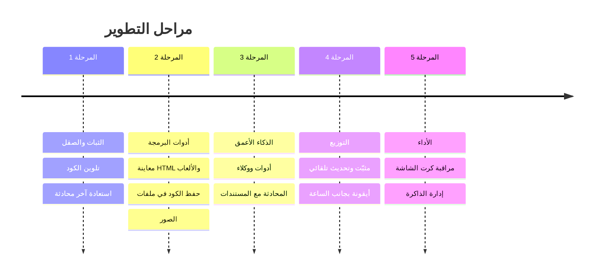

# خارطة التحسينات — Lemon

**الإصدار الحالي:** 2.2.0 (Rust + WebView2) · **القادم:** 2.3.0 موقّع (قطار 13 نوفمبر 2026)
**الحالة: صيانة فقط.** لا ميزات جديدة، لأن Ollama يوفّر تطبيقه الخاص ولا ميزة تنفرد بها Lemon. نكمل توقيع التحديثات وسجل الانهيارات، ونصلح الأخطاء، ونرد على البلاغات خلال أسبوعين.
الخطة العامة لكل البرامج في [صفحة الحساب](https://github.com/sarmadiq9090-coder/sarmadiq9090-coder/blob/main/ROADMAP.md). وموعد كل تغيير يحدّده [معلَم قطار الجمعة](https://github.com/sarmadiq9090-coder/local-ai-chat/milestones) (`train-YYYY-MM-DD`، الساعة 09:00 بتوقيت بغداد). لا يصدر أكثر من إصدار واحد في الأسبوع.

## الخطة الحالية (من نوفمبر 2026)

### المرحلة 1: الأساس (6 و13 نوفمبر)
- [ ] **قطار 13 نوفمبر، الإصدار 2.3.0 الموقّع.** ترتيب الدمج: [#2](https://github.com/sarmadiq9090-coder/local-ai-chat/pull/2) (`CLAUDE.md`)، ثم [#3](https://github.com/sarmadiq9090-coder/local-ai-chat/pull/3) (تحديثات موقّعة بـ minisign، وهو البند 4.7)، ثم [#4](https://github.com/sarmadiq9090-coder/local-ai-chat/pull/4) (سجل الانهيارات `crash.txt`، وهو البند 1.7). لا يصدر قبل نجاح التشغيل التجريبي (dry run).
- [ ] **على المالك قبل 13 نوفمبر:** بيئة `release` بموافقته، ومفاتيح minisign من Codespace (الخطوات في `RELEASING.md` التي تأتي مع #3). إذا لم تجهز المفاتيح ينتقل الإصدار إلى قطار 20 نوفمبر.
- [ ] قسم Lemon في صفحة الخصوصية الموحّدة على fastkiwi.app.

### المرحلة 2: الثقة (من 20 نوفمبر إلى 11 ديسمبر)
- [ ] winget: لا نلمس طلب 2.2.0 المقبول، ونؤتمت التحديثات (wingetcreate) بعد دمجه.
- [ ] اختياري: إبلاغ Microsoft (WDSI) بأن تحذير Defender على البرنامج إنذار خاطئ.

### خارج الخطة
ميزات جديدة (كل بنود المراحل 1 إلى 5 أدناه مجمّدة)، والمتجر، والشهادات المدفوعة.

### قائمة فحص الإصدار والتراجع
بعد دمج #3، الخطوات الكاملة في [RELEASING.md](RELEASING.md). هنا ملخّصها، وخطة التراجع غير الموجودة هناك:
1. **CI ناجح** على `main`.
2. **رقم الإصدار وCHANGELOG يوم الجمعة فقط:** `version` في `Cargo.toml` و`CHANGELOG.md`.
3. **التشغيل التجريبي:** **Actions ← Release ← Run workflow**. يبني البرنامج ويوقّعه بمفتاح مؤقت، ولا ينشر شيئًا.
4. **قائمة الملفات:** بالضبط `local-ai-chat.exe` و`local-ai-chat.exe.sha256` و`local-ai-chat.exe.minisig`، والإصدار «Latest» وليس مسودة.
5. **نسخة محدَّثة واحدة:** على جهاز فيه الإصدار السابق: **الإعدادات ← التحديثات ← التحقق من التحديثات ← تحديث الآن**، ثم تأكّد من الرقم الجديد.

**التراجع عن إصدار سيئ:**
1. حوّل الإصدار السيئ إلى **مسودة**: `gh release edit vX.Y.Z --draft=true -R sarmadiq9090-coder/local-ai-chat`. بعدها لا يراه المحدِّث. إن رفض GitHub ذلك (مثلًا لإصدار غير قابل للتعديل)، فاجعله إصدارًا تجريبيًا (pre-release).
2. أصلح المشكلة، وأصدر **x.y.z+1** (مثلًا 2.3.1). لا تُعِد استخدام الرقم، ولا تحذف الوسم.
3. المحدِّث لا ينزل إلى إصدار أقدم أبدًا. من ثبّت الإصدار السيئ يبقى عليه حتى يصدر x.y.z+1.

### English summary
**Status: maintenance only.** No new features (Ollama ships its own app, so Lemon has no wedge). Bug fixes, crash reports answered within 2 weeks, at most one release a week, on the Friday trains (`train-YYYY-MM-DD` milestones, 09:00 Baghdad).
- **Nov 13 train, 2.3.0 signed:** merge #2 (CLAUDE.md) → #3 (minisign signed updates) → #4 (crash log), gated on the Release dry run. The owner sets up the `release` environment and minisign keys first, or the release slips to Nov 20.
- **Phase 2:** automate winget updates (wingetcreate) once the validated 2.2.0 PR merges. Optional: a WDSI false-positive submission.
- **Release checklist:** CI green; version bump and CHANGELOG on Friday only; dry run (**Actions → Release → Run workflow**); assets exactly `local-ai-chat.exe`, `.sha256`, `.minisig`; one updated install. Details are in [RELEASING.md](RELEASING.md), which arrives with #3.
- **Rollback:** turn the bad release back into a draft (`gh release edit vX.Y.Z --draft=true`), or mark it pre-release if GitHub refuses. Then ship x.y.z+1. Updaters never downgrade.

---

## السجل: الخطة السابقة (مجمّدة)

ما يلي هو الخطة قبل نوفمبر 2026، ونبقيه للتاريخ. البنود غير المنجزة **لن تُنفّذ** ما دامت Lemon في وضع الصيانة.

**الهدف السابق:** برنامج ويندوز محلي للمحادثة وبرمجة التطبيقات والألعاب، يقترب في تجربته من Claude و ChatGPT.

**مفتاح الجدول:**
- **الجهد:** 🟢 صغير (ساعات) · 🟡 متوسط (يوم أو يومان) · 🔴 كبير (عدة أيام)
- **الأولوية:** ⭐⭐⭐ ضروري · ⭐⭐ مهم · ⭐ إضافي

---

## ✅ المنجز في الإصدار 2.0

برنامج exe واحد بنافذة خاصة · واجهة بأسلوب ChatGPT/Claude · دعم كامل للعربية (RTL) · حفظ المحادثات على القرص · إعدادات (تعليمات النظام، درجة الإبداع، طول السياق، الثيم) · تنزيل الموديلات وحذفها من داخل البرنامج · نسخ الرسائل وإعادة توليدها وتعديلها · إرفاق ملفات نصية · بحث وإعادة تسمية · تصدير إلى Markdown · تشغيل Ollama تلقائيًا · نسخة واحدة فقط من البرنامج · أيقونة خاصة.

## ✅ المنجز في الإصدار 2.1

تلوين الكود (بدون إنترنت) · **معاينة مباشرة** لكود HTML/JS/SVG مع التقاط الأخطاء وزر «اطلب الإصلاح» · **المساعدون المخصّصون** (RAG: ملفات PDF ونصوص وملاحظات، وضع صارم، عرض المصادر) · **العربية والإنجليزية** مع تبديل فوري · **اقتراح الموديلات حسب قوة الجهاز** · **تحديث تلقائي** من GitHub Releases · حماية الخادم المحلي من طلبات المواقع الأخرى · أيقونة جديدة · إعادة تنظيم الكود في مجلدات ميزات + دليل للوكلاء (`CLAUDE.md`) · نشر مفتوح المصدر (MIT) مع CI.

---

## المرحلة 1: الثبات والصقل

| # | التحسين | الوصف | الجهد | الأولوية | الملفات |
|---|---|---|---|---|---|
| 1.1 | اختبار الميزات غير المجرّبة | إيقاف الرد، الإرفاق، السحب والإفلات، تنزيل موديل، التصدير | 🟢 | ⭐⭐⭐ | — |
| ✅ 1.2 | تلوين الكود | مكتبة `highlight.js` مضمّنة داخل البرنامج (بدون إنترنت) | 🟢 | ⭐⭐⭐ | `ui/core/markdown.js`, `ui/vendor/` |
| ✅ 1.3 | أخطاء JSON موحّدة | تحويل رفض الطلبات (413، صيغة خاطئة) إلى `{"error"}` (آخر نقطة من المراجعة) | 🟢 | ⭐⭐ | `src/error.rs` |
| ✅ 1.4 | استعادة آخر محادثة | عند فتح البرنامج تعود لآخر محادثة كانت مفتوحة | 🟢 | ⭐⭐ | `ui/features/sidebar/` |
| 1.5 | عنوان تلقائي ذكي | الموديل يقترح عنوانًا قصيرًا للمحادثة بعد أول رد | 🟢 | ⭐⭐ | `ui/features/chat/` |
| 1.6 | تذكّر حجم النافذة ومكانها | تفتح النافذة بنفس الحجم والمكان كل مرة | 🟢 | ⭐ | `src/window.rs` |
| 1.7 | سجل الأخطاء | ملف log في مجلد البيانات لتشخيص المشاكل | 🟢 | ⭐⭐ | `src/main.rs` |

## المرحلة 2: أدوات البرمجة (للتطبيقات والألعاب)

| # | التحسين | الوصف | الجهد | الأولوية | الملفات |
|---|---|---|---|---|---|
| ✅ 2.1 | **معاينة مباشرة** | زر «تشغيل» على كود HTML/JS يفتح لوحة جانبية تعرض الصفحة أو اللعبة فورًا (مثل Artifacts في Claude) | 🟡 | ⭐⭐⭐ | `ui/features/preview/` |
| 2.2 | حفظ الكود في ملف | زر «حفظ» على كتلة الكود يحفظها في مجلد مشروع تختاره | 🟢 | ⭐⭐⭐ | `src/server/routes/`, `ui/core/markdown.js` |
| 2.3 | مجلد مشروع | ربط المحادثة بمجلد، وإرفاق عدة ملفات منه دفعة واحدة | 🟡 | ⭐⭐ | `src/workspace.rs` (جديد) |
| 2.4 | قوالب تعليمات | «مبرمج ألعاب»، «مطوّر ويب»، «مترجم»، «معلّم»… لكل قالب تعليماته وموديله | 🟢 | ⭐⭐ | `src/config.rs`, `ui/features/settings/` |
| 2.5 | موديل تلقائي حسب المهمة | أسئلة الكود تذهب إلى موديل البرمجة، والمحادثة إلى موديل المحادثة | 🟢 | ⭐ | `ui/features/models/` |
| 2.6 | الصور | لصق صورة وسؤال موديل رؤية عنها (مثل `qwen2.5vl` أو `gemma3`) | 🟡 | ⭐⭐ | `ui/features/chat/` |
| 2.7 | عرض الفروقات (diff) | عند تعديل كود سابق يظهر ما تغيّر بالألوان | 🟡 | ⭐ | `ui/core/markdown.js` |

## المرحلة 3: الذكاء الأعمق

### 🧠 3.0 المساعدون المخصّصون (تعليم الذكاء بمعلوماتك) — ✅ منجز في 2.1

مثل Custom GPTs في ChatGPT و Projects في Claude: تنشئ «مساعدًا» وتعطيه معلوماتك، فيبحث فيها ويجيب منها فقط.

| الميزة | الوصف |
|---|---|
| إنشاء مساعد | اسم، أيقونة، تعليمات خاصة، وموديل مفضّل |
| قاعدة معرفة | رفع ملفات (TXT، MD، كود، PDF) + كتابة ملاحظات أو أسئلة وأجوبة مباشرة |
| فهرسة ذكية | تقطيع النصوص وتحويلها إلى متجهات (embeddings) بموديل محلي يدعم العربية، مثل `bge-m3` |
| الاستدعاء | عند كل سؤال يبحث عن أقرب المقاطع ويرسلها للموديل مع السؤال |
| **الوضع الصارم** | يجيب **فقط** مما أعطيته؛ إن لم يجد الجواب يقول «لا توجد هذه المعلومة في المعرفة المعطاة» |
| المصادر | تحت كل رد تظهر المقاطع والملفات التي اعتمد عليها |
| الإدارة | إضافة الملفات وحذفها وإعادة الفهرسة، والمحادثة مع المساعد من الشريط الجانبي |

> **ملاحظة عن «التدريب»:** الطريقة أعلاه (RAG) هي الأنسب لجهازك: فورية، ولا تحتاج تدريبًا ثقيلًا، وتتحدّث بمجرد إضافة ملف. أما **التدريب الحقيقي (Fine-tuning)** الذي يغيّر أسلوب الموديل نفسه فمذكور في البند 3.6.

| # | التحسين | الوصف | الجهد | الأولوية | الملفات |
|---|---|---|---|---|---|
| ✅ 3.0 | **المساعدون المخصّصون** | انظر الجدول أعلاه | 🔴 | ⭐⭐⭐ | `src/assistants/`, `ui/features/assistants/` |
| 3.1 | **أدوات (Tool calling)** | الموديل يقرأ الملفات ويكتبها ويشغّل أوامر داخل مجلد المشروع، **بعد موافقتك** على كل خطوة | 🔴 | ⭐⭐⭐ | `src/tools/` (جديد)، `ui/features/chat/` |
| 3.2 | فهرسة مجلد مشروع كامل | توسعة لـ 3.0: ربط مساعد بمجلد كود يُفهرس تلقائيًا عند تغيّر الملفات | 🟡 | ⭐⭐ | `src/assistants/` |
| 3.3 | مقارنة موديلين | نفس السؤال لموديلين جنبًا إلى جنب | 🟡 | ⭐ | `ui/features/compare/` (جديد) |
| 3.4 | ذاكرة طويلة | يتذكر معلومات عنك عبر المحادثات (يمكن تعطيلها) | 🟡 | ⭐ | `src/memory.rs` (جديد) |
| 3.5 | تلخيص المحادثات الطويلة | عند امتلاء السياق يلخّص الرسائل القديمة بدل أن يقطعها | 🟡 | ⭐⭐ | `ui/features/chat/` |
| 3.6 | تدريب حقيقي (Fine-tuning بـ LoRA) | تعليم موديل صغير (3–4B) أسلوبك من أمثلة سؤال/جواب. يحتاج Python و Unsloth، وكرت 8GB يكفي للموديلات الصغيرة فقط. الناتج يُضاف إلى Ollama كموديل جديد | 🔴 | ⭐ | `training/` (جديد) |

## المرحلة 4: التوزيع والتجربة

| # | التحسين | الوصف | الجهد | الأولوية | الملفات |
|---|---|---|---|---|---|
| 4.1 | مثبّت (Setup) | ملف تثبيت فيه اختصارات وإلغاء تثبيت (Inno Setup أو WiX) | 🟡 | ⭐⭐ | `installer/` (جديد) |
| 4.2 | أيقونة بجانب الساعة | يبقى البرنامج يعمل في الخلفية، مع اختصار عام (مثل Alt+Space) لفتحه | 🟡 | ⭐⭐ | `src/tray.rs` (جديد) |
| 4.3 | نافذة سريعة | سؤال سريع فوق أي برنامج بدون فتح النافذة الكاملة | 🟡 | ⭐ | `src/window.rs` |
| ✅ 4.4 | واجهة إنجليزية | اختيار اللغة من الإعدادات  | 🟢 | ⭐ | `ui/features/*/strings.js` |
| 4.5 | نسخ احتياطي واستيراد | تصدير كل المحادثات والإعدادات واستيرادها | 🟢 | ⭐⭐ | `src/server/routes/` |
| 4.6 | إدخال صوتي | التحدث بدل الكتابة (Whisper محلي) | 🔴 | ⭐ | — |
| 4.7 | توقيع الإصدارات (minisign/Authenticode) | توقيع ملف البرنامج والتحقق من التوقيع في المحدّث، لا مجرد checksum (يثبت هوية الناشر ويقلّل تحذيرات SmartScreen) | 🟡 | ⭐⭐ | `src/update.rs`, `.github/workflows/` |

## المرحلة 5: الأداء والعتاد

| # | التحسين | الوصف | الجهد | الأولوية | الملفات |
|---|---|---|---|---|---|
| 5.1 | مراقبة كرت الشاشة | عرض الموديل المحمّل واستهلاك الذاكرة (من `/api/ps`) | 🟢 | ⭐⭐ | `ui/features/models/` |
| 5.2 | تفريغ الموديل | زر لإخراج الموديل من الذاكرة، وإعداد مدة بقائه (`keep_alive`) | 🟢 | ⭐⭐ | `ui/features/models/`, `src/config.rs` |
| ✅ 5.3 | توصيات حسب الجهاز | اقتراح موديلات تناسب كرت الشاشة (8GB) والرام (64GB) عند التنزيل | 🟢 | ⭐⭐ | `ui/features/models/` |
| 5.4 | موديلات أقوى | تجربة `qwen3-coder:30b` و `gpt-oss:20b` وقياس سرعتها | 🟢 | ⭐⭐⭐ | — |

---

## 🎯 الترتيب المقترح للخطوات القادمة (بعد 2.1)

> مجمّد: Lemon في وضع الصيانة، فلن تُنفّذ هذه الخطوات. الخطة الحالية في أعلى الصفحة.

1. **2.2** حفظ الكود في ملفات، ثم **2.4** قوالب التعليمات.
2. **5.4** موديلات أقوى (`qwen3-coder:30b`، `gpt-oss:20b`): تحسّن جودة الردود أكثر من أي ميزة أخرى.
3. **1.4** استعادة آخر محادثة و **1.5** العنوان التلقائي.
4. **2.6** الصور مع موديلات الرؤية.
5. **3.1** الأدوات والوكلاء: تقرّب البرنامج من Claude Code.
6. **4.1** مثبّت (Setup) و **4.2** أيقونة بجانب الساعة.

## طريقة إضافة ميزة

راجع [CLAUDE.md](CLAUDE.md) (دليل المطوّرين والوكلاء) و[CONTRIBUTING.md](CONTRIBUTING.md)، وعقد الـ API في [docs/API.md](docs/API.md).
